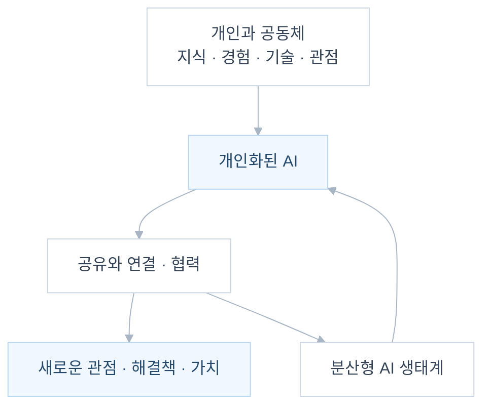

# 모두의 AI

## 사업 소개

모두의 AI는 개인과 공동체가 가진 다양한 지식과 경험, 기술과 관점을 AI를 통해 연결하고, 서로 다른 가치의 결합으로 새로운 가치를 창출하는 생태계를 만들어가는 프로젝트입니다.

AI 산업은 소수의 대규모 플랫폼과 거대 모델을 중심으로 성장하고 있습니다. 이러한 구조에서는 AI 기술과 지식이 특정 기업에 집중되기 쉽고, 사람들은 주어진 AI를 소비하는 역할에 머무르기 쉽습니다. 하지만 사람마다 가진 지식과 경험, 관심과 목적은 서로 다르며, 이러한 차이는 새로운 가능성을 만들어내는 중요한 자산입니다.

모두의 AI는 이러한 다양성에 주목합니다. 개인이 자신의 목적과 필요에 맞는 AI를 만들고 활용할 수 있도록 기술과 도구를 제공하며, 각자의 지식과 경험이 AI를 통해 확장되고 공유될 수 있는 환경을 지향합니다.

개별적으로 존재하는 지식과 기술, 아이디어가 서로 연결되고 협력하면 혼자서는 만들기 어려웠던 새로운 관점과 해결책, 새로운 가치가 만들어질 수 있습니다. 모두의 AI는 이러한 연결과 협력을 통해 개인의 가능성을 공동체의 가능성으로 확장하고자 합니다.

이를 위해 개인화된 AI의 개발과 활용을 지원하고, 다양한 지식과 기술이 공유되고 협력할 수 있는 분산형 생태계를 구축해 나갑니다. 또한 모든 작업에 거대한 모델이 필요한 것은 아니라는 점에 주목하여, 작은 규모의 개인화된 모델과 효율적인 연산 자원을 활용함으로써 에너지 소비와 환경 부담을 줄이는 지속가능한 기술 환경을 추구합니다.

모두의 AI는 하나의 거대한 AI가 모든 것을 대신하는 세상이 아닙니다. 서로 다른 지식, 경험이 모이고 연결되어 새로운 가능성을 추구합니다.

## 모두의 AI가 만드는 연결

## 사업의 배경과 방향

- [01. 시작하게 된 계기](#intro/01-origin) — 추론의 도구는 어떻게 AI 상품이 되었는가?
- [02. 문제 인식](#intro/02-problem) — 현재 AI 시장의 구조와 우리가 해결하려는 문제
- [03. 사업 방향과 핵심 원칙](#intro/03-principles) — 사업의 가치와 운영의 기준

## 핵심 사업 영역

모두의 AI는 세 가지 사업 영역을 중심으로 개인과 공동체의 AI 활용 환경을 넓혀 갑니다.

- [04. 개인 맞춤형 AI 환경](#intro/04-personal-ai) — 목적과 환경에 맞는 AI를 선택하고 구성하는 기반
- [05. 보편성과 대중화](#intro/05-accessibility) — 기술적·경제적 진입장벽을 낮추는 환경
- [06. 분산 지식 생태계](#intro/06-ecosystem) — 다양한 모델과 지식, 경험이 연결되는 구조

## 사업 실행 계획

현재의 자원과 역량을 바탕으로 실행 가능한 과제부터 추진하고, 실제 수요와 검증 결과에 따라 사업을 발전시킵니다.

- [07. 단기 목표](#intro/07-short-term-goals) — 초기 사업 기반과 실행 과제
- [08. 사업 추진 전략](#intro/08-strategy) — 핵심 영역별 실행 방법과 단계
- [09. 사업 모델과 지속가능성](#intro/09-business-model) — 장기적인 사업 모델과 운영 기반
- [10. 장기 목표](#intro/10-long-term-goals) — AI 생태계의 단계적 확장

## 비전

### 다양성이 공존하는 AI 생태계

하나의 AI가 모든 것을 대신하는 세상이 아니라, 서로 다른 지능과 관점이 함께 성장하는 세상.

[11. 비전 자세히 보기](#intro/03-vision)

---

각 문서는 사업과 개발의 진행에 따라 구체적인 내용과 실행 기준을 보완합니다. 현재 제시된 방향이 모든 기능과 서비스가 이미 구현되었다는 의미는 아닙니다.
