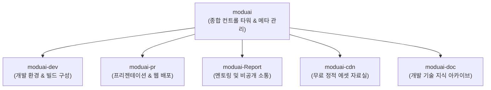
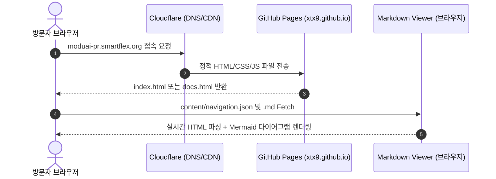

# moduai 시스템 아키텍처

> 파일명: content/intro/02-architecture.md  
> 최종 수정일: 2026-11-27  
> 분류: 시스템 아키텍처  

---

## 1. 6개 독립 저장소 연계 구조

모두의 AI 프로젝트는 역할과 책임을 명확히 분리한 6개의 특화 저장소로 구성되어 있습니다.

---

## 2. 웹 서비스 및 배포 파이프라인

`moduai-pr`은 복잡한 서버리스 빌드 없이 GitHub Pages와 Cloudflare의 장점을 결합하여 0ms에 가까운 초고속 로딩을 제공합니다.

---

## 3. 저장소별 세부 역할 명세

1. **`moduai`**: 전체 프로젝트의 총괄 컨트롤 타워 및 규칙(AGENTS.md) 수립
2. **`moduai-pr`**: 일반 대중, 투자자, 평가위원을 위한 공식 쇼케이스 및 강의 사이트
3. **`moduai-dev`**: 실제 AI 모델 학습 및 로컬/GCP 서버 배포 코드베이스
4. **`moduai-cdn`**: 이미지, PDF, 대용량 바이너리 파일을 위한 무과금 CDN 허브
5. **`moduai-doc`**: 프롬프트 엔지니어링 및 오픈소스 모델 튜닝 지식 저장소
6. **`moduai-Report`**: 정부 지원사업(모두의 창업) 주관기관 및 멘토 전용 비공개 레포트
