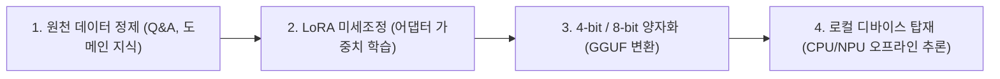

# 제2강: 소버린 모델 구축법

> 파일명: content/lectures/chapter-02.md  
> 강의 레벨: 중급 (Intermediate)  
> 소요 시간: 약 25분  

---

## 1. 학습 목표

- 소형 언어 모델(sLLM)의 데이터 수집과 정제 절차를 익힙니다.
- LoRA(Low-Rank Adaptation)를 통한 저비용 미세조정(Fine-Tuning) 원리를 학습합니다.
- 양자화(Quantization)를 통해 일반 PC에서 모델을 효율적으로 구동하는 방법을 알아봅니다.

---

## 2. 모델 최적화 및 경량화 파이프라인

소버린 모델을 일반 장치에 탑재하기 위해서는 아래의 4단계 압축 파이프라인을 거치게 됩니다.



---

## 3. 양자화(Quantization) 코드 예제

아래는 16비트 모델을 4비트로 경량화하여 메모리 사용량을 절감하는 파이썬 코드 예시입니다.

```python
# 파일명: quantize_example.py
import torch
from transformers import AutoModelForCausalLM, BitsAndBytesConfig

# 4비트 양자화 설정 (VRAM 부담 최소화)
bnb_config = BitsAndBytesConfig(
    load_in_4bit=True,
    bnb_4bit_compute_dtype=torch.float16,
    bnb_4bit_quant_type="nf4"
)

print("저전력 소버린 모델 구성 준비가 완료되었습니다.")
```

---

## 4. 정리 및 다음 단계

고가의 서버 인프라 없이도 목적에 부합하는 소형 모델을 구축하고 로컬 장치에 탑재할 수 있습니다.  
다음 과정에서는 실제 디바이스 및 API 서비스 연동 기법을 다룹니다.
